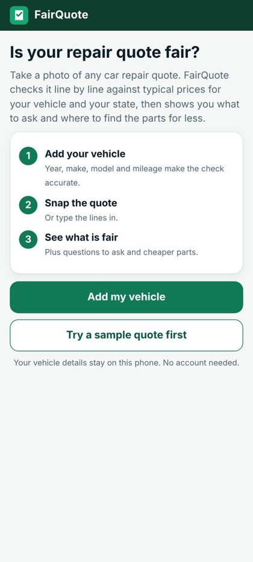
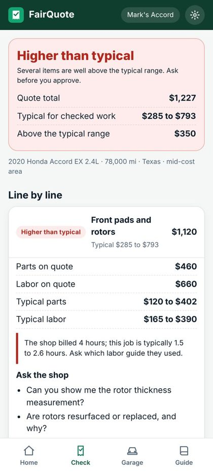
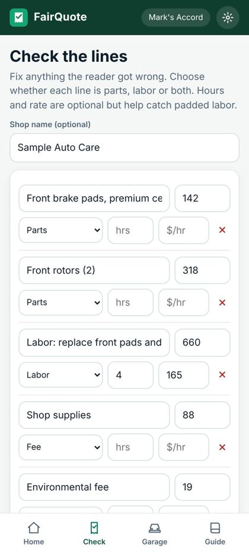

# FairQuote

**Is your repair quote fair?** FairQuote reads a car repair quote from a photo and checks it line by line for your exact vehicle, mileage and state, with questions to ask, how-to videos, cheaper parts, a nearby shop map and a shareable PDF summary.

[Download the Android app](https://github.com/quuxin2-a11y/fairquote/releases/download/latest/fairquote.apk) · [Website with the web app, business plan and partner information (password protected)](https://quuxin2-a11y.github.io/fairquote/site.html)

## What it does

- **Vehicle profile instead of a login:** year, make, model, body, fuel, mileage, state and ZIP, stored on the phone. No account.
- **Photo or typed quotes**, with a review screen to fix any misread line.
- **42 common repairs** priced for your vehicle class and state, with fee, labor-rate, billed-hours, mileage and electric-vehicle checks.
- **Questions to ask the shop** for anything above the typical range.
- **Do-it-yourself help:** difficulty, time, tools, how-to videos that play inside the app and parts search links at several stores.
- **Nearby repair shop map** inside the app.
- **PDF summary** with logo and a QR code, shared through the Android share sheet.

Version 1 uses starter price estimates, not licensed labor-guide data. Treat results as a guide.

## How it is built

| File | Purpose |
| --- | --- |
| `index.html`, `app.css`, `app.js` | The app: plain JavaScript, no framework |
| `data.js`, `engine.js` | Price data and the pure check engine, shared by the app and the tests |
| `qr.js`, `pdf.js`, `report.js` | QR code generator, PDF writer and the summary report, with no dependencies |
| `worker.js` | Cloudflare Worker that reads quote photos, finds how-to videos and serves map settings, so no key lives in the app |
| `tests.js`, `worker.test.mjs` | Automated tests, run on every build |
| `site*.html` | The password-protected website (encrypted pages) |
| `.github/workflows/apk.yml` | Builds the Android app with Capacitor on every push |

Run the tests: `node tests.js` and `node worker.test.mjs`.

## Get the app

Every push to `main` runs the tests and publishes `fairquote.apk` under [Releases](../../releases). Uninstall an older build before installing a new one.

## Set up the quote reader and videos

See [SERVER-SETUP.md](SERVER-SETUP.md). It takes about ten minutes on a free Cloudflare account.

## Privacy

See [PRIVACY.md](PRIVACY.md). Vehicle details and history stay on the phone.

## License

Copyright © Mark Joseph. All rights reserved. See [LICENSE](LICENSE).
